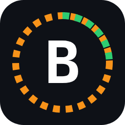
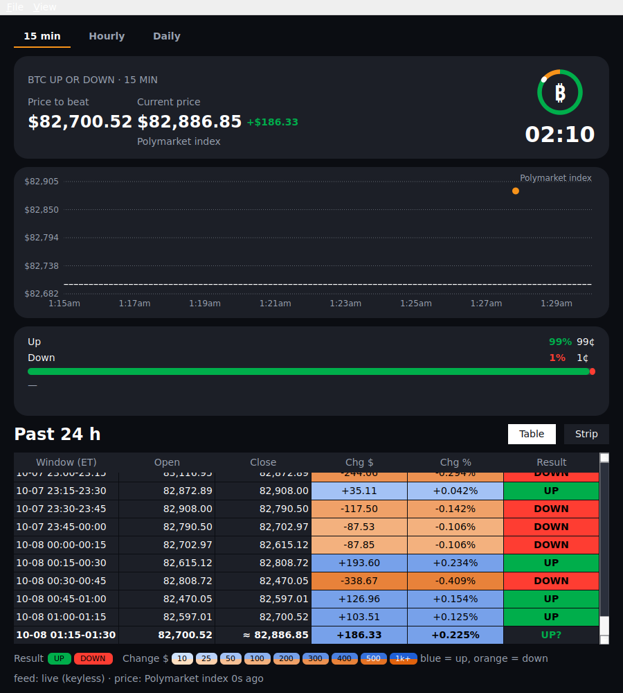
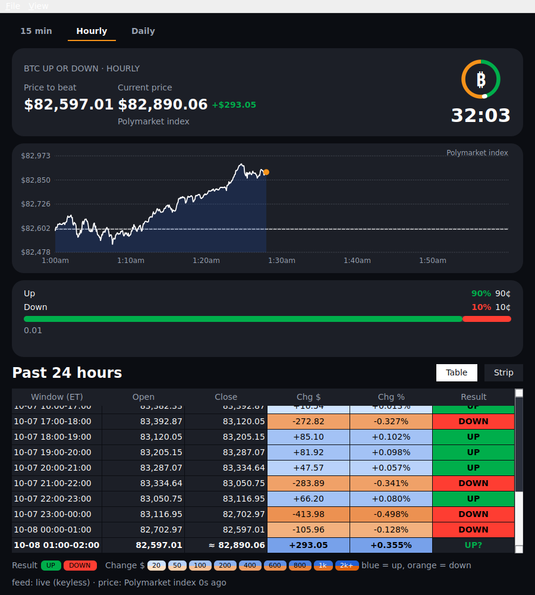
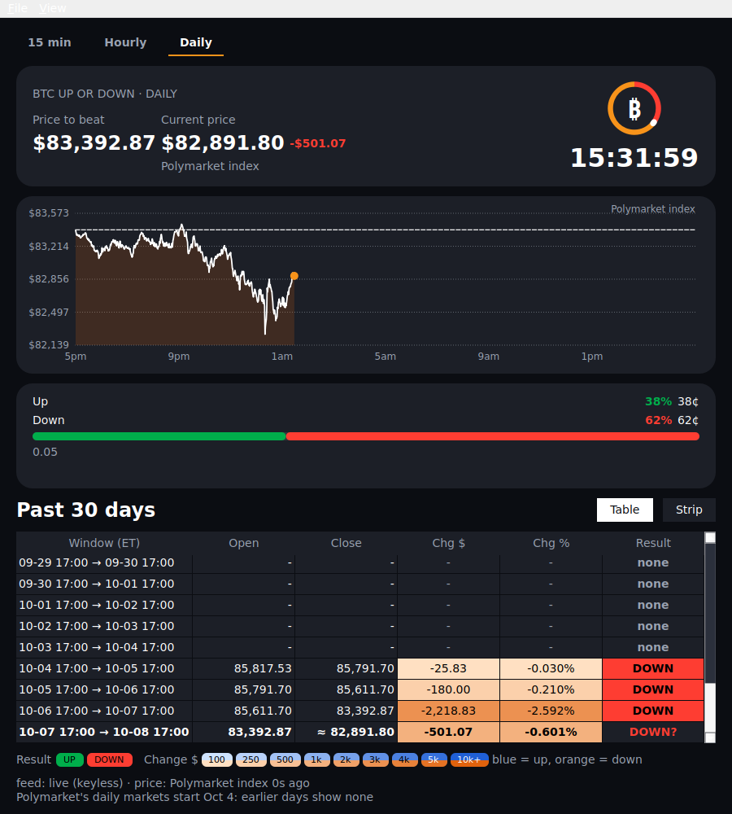

<p align="center"></p>

# Live Bitcoin Tracker

A live tracker for Polymarket US's **"Bitcoin Up or Down"** markets, in three time frames in one window:

| Tab | Shows | History | Closes |
|---|---|---|---|
| **15 min** | the live 15-minute window: price chart, Up/Down odds, countdown | last 24 hours (96 windows) | every quarter hour |
| **Hourly** | the same for the live hour | last 24 hours (24 windows) | every hour on the hour |
| **Daily** | the same for the live day | last 30 days (30 windows) | 5:00 PM ET, whenever Polymarket's daily market closes |

Each tab has the same design: the live price against the price to beat, a countdown, the odds, and a colour-coded
history table (result green/red, change in dollars blue/orange). Switch tabs with the buttons or the **1**, **2**, **3** keys.





> **Unofficial.** Not affiliated with, endorsed by, or connected to Polymarket or CF Benchmarks.
> Read-only market data. Nothing here places orders, and nothing here is financial advice.

**Status (v0.1.0):** **Linux and Windows are tested**: the Windows build was built, tested (423 tests) and run with live data on a
Windows Server 2022 machine, and Linux is used daily. **macOS is built and checked by automated tests, but is visually untested**:
nobody has looked at it on a real Mac yet. Design notes: [`docs/DESIGN.md`](docs/DESIGN.md).

## Install

### Easiest: with Python (no security warnings)

If you can install [uv](https://docs.astral.sh/uv/) (a one-line install; it also fetches Python for you), this is the smoothest route.
Windows and macOS only show their "unknown app" warnings for files downloaded in a browser, and this route has none.

```
# 1. install uv once (Linux and macOS):
curl -LsSf https://astral.sh/uv/install.sh | sh
#    ...or on Windows, in PowerShell:
#    powershell -ExecutionPolicy ByPass -c "irm https://astral.sh/uv/install.ps1 | iex"

# 2. install and run the tracker:
uv tool install "live-bitcoin-tracker[gui] @ git+https://github.com/anjavera/live-bitcoin-tracker"
bitcoin-tracker
```

Options: `--timeframe 15m|1h|1d` (otherwise it opens on the tab you used last), `--keyless` (ignore any API keys),
`--snapshot out.png` (save a picture and exit). To update later: run the `uv tool install` line again with `--force`.

### Or download the app (no Python needed)

Download the file for your computer from the [Releases page](../../releases/latest) and run it.

| Your computer | Download | How to start it |
|---|---|---|
| **Windows** | `bitcoin-tracker-windows-x86_64.exe` | Double-click it. Windows will say it "protected your PC" because the app is **not code-signed yet**: click **More info**, then **Run anyway**. |
| **Mac** (Apple Silicon) | `bitcoin-tracker-macos-arm64.zip` | Unzip it, then right-click **bitcoin-tracker** and choose **Open** the first time (the app is not code-signed). **Not yet looked at on a real Mac, see the status above.** |
| **Linux** | `bitcoin-tracker-linux-x86_64` + `install-gui.sh` | In the download folder run `sh install-gui.sh`. This adds **Live Bitcoin Tracker** to your app menu. On an X11 desktop you may also need `sudo apt install libxcb-cursor0`; the app tells you if so. |

Code signing costs money or needs an approval process, so it is not in place for this first release; we are applying for free
signing for open-source projects (see [Code signing policy](#code-signing-policy)). Until it is in place, the warning is expected and
the files are built automatically from this repository by the public release workflow. If something does not work on your
system, please [open an issue](../../issues) with what you saw.

**Using the app:** keys **1 / 2 / 3** switch tabs, **v** table/strip, **r** reloads, **Ctrl+Q** quits. The **View** menu has a local-time
option and always-on-top.

The look is modelled on Polymarket's own market page (dark theme, green Up / red Down). The live price comes from
Polymarket's own BTC index, the one the markets settle on; if that is unavailable the window falls back to an
exchange average and marks it "approx.".

### Terminal version (15 minutes only)

There is also a terminal widget for the 15-minute market: `bitcoin-tracker-tui-<system>` on the Releases page
(Linux has `install.sh`), or `uv tool install git+https://github.com/anjavera/live-bitcoin-tracker` then
`bitcoin-tracker-tui`. Press **q** to quit; the window needs to be at least 80 columns by 16 rows.

## How the three time frames settle

All three are settled by Polymarket on **CF Benchmarks' Bitcoin Real-Time Index (BRTI)**. At each boundary the official
value is the simple average of the 60 BRTI prices in the last minute before it, rounded to 2 decimals; the window is **Up** if the
end value is greater than or equal to the start value. This tracker shows Polymarket's own published open and close,
so the history is exact. The live gap and the "UP?/DOWN?" mark are provisional because they use the latest price, not a
60-second average. The daily window runs from 5:00 PM ET to 5:00 PM ET, so it follows daylight saving time and is 23 or 25
hours long on the two days the clocks change.

Polymarket US started its daily markets on 4 October 2026, so the first rows of the 30-day table read **none** until
there are 30 days of history; the hourly and 15-minute markets go back further.

## No API keys needed

The live widget and `pm btc15` read only **public** Polymarket US data and public exchange prices, so there is
nothing to sign up for or configure. Just run it.

## Optional: use your own Polymarket US API keys

Keys are optional. With keys the widget switches automatically to Polymarket's faster live feed (updates are
pushed to you instead of polled every 2 seconds), and you can use the account commands (`pm account`,
`balances`, `positions`, `orders`). **Everyone needs their own keys: never share or reuse
anyone else's.**

How to get your own keys (from Polymarket US's official docs,
<https://docs.polymarket.us/api-reference/authentication>):

1. Download the **Polymarket US app** and create an account.
2. Complete **identity verification** in the app.
3. Go to <https://polymarket.us/developer> and sign in **the same way you sign in to the app** (Apple, Google or
   email). Switching sign-in methods can break your key.
4. Create a new key. You get a **Key ID** and a **Secret Key**. The secret key is shown **only once**: copy it
   somewhere safe before closing the dialog.
5. Put them in a file named `.env` in this project's folder (or set them as environment variables):

   ```
   POLYMARKET_KEY_ID=your-key-id
   POLYMARKET_SECRET_KEY=your-secret-key
   ```

The widget finds the keys by itself; the status line then shows `feed: live (keyed)`. To ignore your keys and use
public data only, run `bitcoin-tracker-tui --keyless` (the status line shows `feed: live (keyless)`).

**Keep your keys safe.** Polymarket's keys can be used to place orders including other functions involving your money. Treat the keys as if they were the full details to your credit/debit cards. `.env` is git-ignored here; never commit it or paste it anywhere. If a key is ever
exposed, revoke it at <https://polymarket.us/developer>. This project only reads data and never places orders.

## Usage

```
uv sync --extra gui
uv run bitcoin-tracker                      # desktop window: 15 min, hourly and daily tabs
uv run bitcoin-tracker --timeframe 1d       # start on the daily tab
uv run bitcoin-tracker-tui                  # live terminal widget (15 minutes; add --keyless to ignore any API keys)
uv run bitcoin-tracker-tui --snapshot       # print one plain-text frame and exit
uv run pm btc15 --hours 6                   # one-shot styled table, last 6 hours (add --volume for volumes; slower)
uv run pytest                               # tests (QT_QPA_PLATFORM=offscreen for the window tests on a server)
```

Terminal widget keys: **q** quit, **v** table/strip view, **r** refresh, arrows/PgUp/PgDn scroll. On terminals of at
least 116 columns by 28 rows an ASCII coin appears whose ring is the analog countdown (orange = time left,
green/red = time used, by the current lean).

Other read-only commands: `uv run pm search "<text>"`, `pm price <market-slug>`, `pm book <market-slug>`,
`pm market <market-slug>`, `pm event <event-slug>`, and (keys needed) `pm account`, `pm balances`, `pm positions`,
`pm orders`. Add `--json` before the command for machine-readable output. Rapid repeated calls can trip a
Cloudflare rate limit; wait a minute.

History for each tab loads with one or two requests, and settled windows are cached locally (one cache file per time frame).
The live price comes from Polymarket's own BTC index (the one the markets settle on). If it is unavailable the app
falls back to an average of Coinbase, Kraken, Bitstamp and Gemini and marks the price as approximate (≈).
Windows are coloured from the real settled result; the live window is provisional. Change bands are scaled to the time
frame (an hour or a day moves more than a quarter hour): the key under the table shows the dollar amounts for the tab you are on.

## Code signing policy

Free code signing provided by [SignPath.io](https://signpath.io), certificate by [SignPath Foundation](https://signpath.org).
*(This applies once an application to SignPath Foundation is approved. Until then the downloads are unsigned.)*

- **How a release is made:** the version tag triggers the public workflow [`release.yml`](.github/workflows/release.yml), which builds the
  apps from this repository's source on GitHub's own servers. Nothing is built on a personal computer.
- **Committers and reviewers:** [anjavera](https://github.com/anjavera). Changes are reviewed and merged by the repository owner.
- **Approvers** (the person who approves each release for signing): [anjavera](https://github.com/anjavera). Every release needs a manual
  approval before it is signed.
- The repository owner uses multi-factor authentication on GitHub and on SignPath.
- Only binaries built from this repository are signed; the third-party libraries it uses are listed in
  [`THIRD_PARTY_NOTICES.md`](THIRD_PARTY_NOTICES.md).

### Privacy

The app collects nothing about you: there is no account, no analytics and no tracking. When it runs it only **reads public market data**.
It requests prices and results from Polymarket's public servers (`gateway.polymarket.us`, `api.polymarket.us`) and, as a fallback price
source, from the public price APIs of Coinbase, Kraken, Bitstamp and Gemini. These requests carry no personal information, only the
market and time range being looked up. If you choose to add your own Polymarket API keys, they are used only to sign requests to
Polymarket and are never sent anywhere else. The app keeps a small cache of settled market results and its window settings on your
own computer. It places no orders.

## Contributing and support

Questions and ideas: [Discussions](../../discussions). Bugs: [open an issue](../../issues/new/choose) (macOS reports are especially welcome, since the
Mac build has not been looked at on a real Mac yet). Want to help: see [CONTRIBUTING.md](CONTRIBUTING.md) and the [Code of Conduct](CODE_OF_CONDUCT.md).
Security problems: report them privately, see [SECURITY.md](SECURITY.md). The project is read-only on purpose and will not add trading features.

## License

[MIT](LICENSE). This project is unofficial and comes with no warranty; see the notice at the top.
